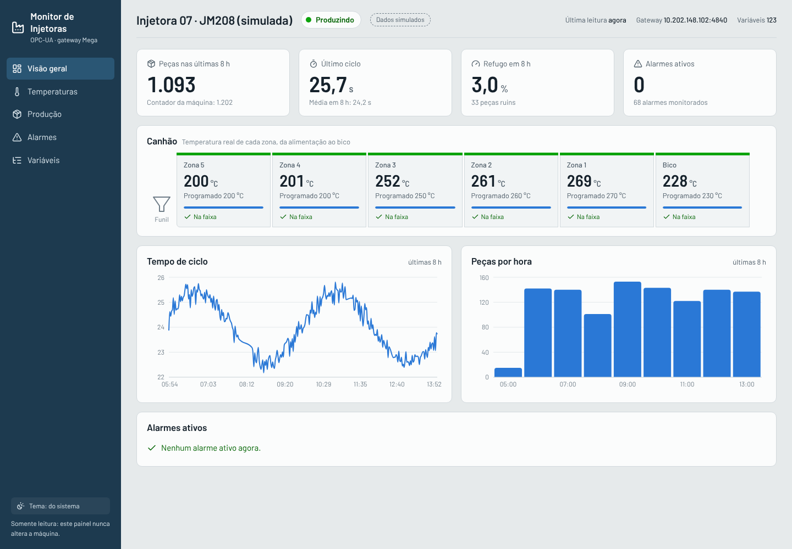
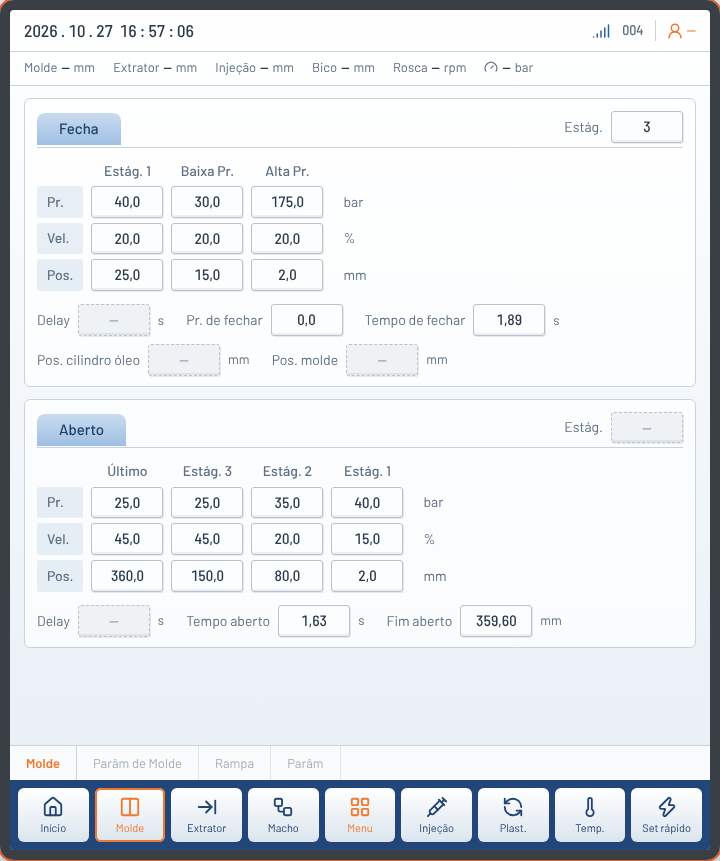

# Monitor de Injetoras

Painel web para acompanhar injetoras Chen Hsong em tempo real, lendo os dados
do servidor **OPC-UA do gateway Mega (CHL3200)**. Mostra estado da máquina,
produção, tempo de ciclo, temperaturas do canhão e alarmes, e guarda histórico
local. A ideia é ter dashboards no estilo do Things OS (Tomorrow Things), sem
depender de uma plataforma paga.



> **Somente leitura.** O monitor só lê variáveis OPC-UA. Não existe nenhuma
> chamada de escrita no código, e um teste automático
> (`test_codigo_nao_escreve_na_maquina`) falha se alguém incluir uma.

## Telas

| Tela | O que mostra |
|---|---|
| Painel da máquina | Réplica das telas da IHM CHY (Início, Molde, Extrator, Macho, Injeção, Plast., Temp., Set rápido) com os valores reais do gateway |
| Visão geral | Peças em 8 h, último ciclo, refugo, alarmes ativos, canhão (zona 5 → bico), ciclo e peças por hora |
| Temperaturas | Real × programado por zona, com a faixa de tolerância da máquina; óleo hidráulico |
| Produção | Peças por intervalo, refugo, ciclo médio, meta da ordem, fases do último ciclo, pressão e colchão |
| Alarmes | Ativos agora, ranking por tempo parado, histórico com início e duração |
| Variáveis | As ~1000 variáveis do gateway, com busca |

Períodos: 1 h, 8 h, 24 h e 7 dias. Tema claro/escuro. Funciona no celular.

## Painel da máquina



Recria as principais telas do painel CHY (layout baseado nas fotos do painel e no
manual *Multifunctional Injection Molding Computer Operating Instructions*). Os
valores vêm do OPC-UA e atualizam a cada poucos segundos: a tela aberta pede as
suas variáveis em `GET /api/values`, que as inclui na leitura rápida.

- Trocar de tela aqui **não** muda a tela do painel físico; nenhum valor é editável.
- Campos com **—** existem no painel, mas o gateway não publica o dado (posições
  em tempo real, delays, nível de acesso). Passe o mouse sobre um valor para ver
  a variável OPC-UA de origem.
- O número de estágios vem do byte baixo das variáveis `*StageSelect`
  (ex.: `HoldPresStageSelect = 131074` → 2 estágios).
- Modos com texto (ex.: `PlastMode 1 = Pos.`, `ColdMode 2 = Durant. Plast.`,
  `EjectMode 3 = Avanç.`) foram conferidos com as fotos; outros códigos aparecem como "modo N".

## Painel B&R (Euromap 63)

Máquinas com painel B&R (ex.: JM228) têm servidor OPC-UA próprio e publicam os
dados no padrão **Euromap 63** (`ns=6;s=::EM63Mapp:pEm63a.*` e `pEm63m.*`). Para
lê-las, use no `.env`:

```
MACHINE_PROFILE=em63
OPCUA_URL=opc.tcp://10.86.20.253:4840
```

O Monitor traduz os campos para os mesmos indicadores da CHY (ciclos, refugo,
tempo de ciclo, fases do ciclo, colchão, pressão, zonas do canhão com tolerância
e óleo). Diferenças: só aparecem as zonas ligadas no painel, não há bico separado,
o contador é de **ciclos** (`ActCntCyc`) e os alarmes vêm só do estado geral da
máquina (`ActStsMach = Error` vira o alarme "Máquina em erro"). A tela *Painel da
máquina* (réplica da IHM CHY) fica oculta nesse modo; os campos brutos aparecem em
*Variáveis* como `EM63.pEm63a.*`.

No lugar dela aparece a **Tela ao vivo**: a IHM real, pelo VNC do painel (porta
5900), dentro do navegador.

### Tela ao vivo: várias pessoas assistindo, um operador por vez

O painel B&R aceita **um cliente VNC só**. Por isso o Monitor é esse cliente (o
*hub*, `backend/app/vnc_hub.py`): ele mantém uma conexão com o painel, guarda a
imagem e a repassa para quantas pessoas quiserem assistir, pelo navegador ou por um
cliente VNC comum, como o Espelho IHM, na porta `VNC_TCP_PORT` (5901).

A senha digitada define o papel, como no Espelho:

| Senha | O que a pessoa pode fazer |
| --- | --- |
| `VNC_VIEW_PASSWORD` (visualização) | Só assiste |
| `VNC_CONTROL_PASSWORD` (operação) | Assiste e pode **assumir o controle** |

Regras de segurança:

- **Enquanto ninguém opera, o hub fica ligado ao painel com a senha de
  visualização**: o próprio painel recusa qualquer toque.
- **Um operador por vez.** No navegador, o operador clica em *Assumir controle* e
  confirma. O hub reconecta no painel com a senha de operação (a tela congela 1 a 2 s)
  e só então repassa cliques e teclas, e **só dessa pessoa**. Num cliente VNC comum,
  o primeiro toque de quem entrou com a senha de operação assume o controle.
- Teclas e cliques de quem só assiste são descartados no servidor. A área de
  transferência nunca vai para o painel.
- **O controle volta sozinho** para visualização depois de `VNC_CONTROL_TIMEOUT`
  segundos sem uso (padrão 300), ou quando o operador libera ou fecha a página.
- Entradas, saídas e trocas de controle ficam em `VNC_AUDIT_PATH`
  (`data/vnc_audit.log`).
- As senhas ficam só no `.env` do servidor; o navegador nunca as recebe. Sem
  `VNC_VIEW_PASSWORD`, a Tela ao vivo fica desligada.
- Quando ninguém está assistindo, o hub solta o painel depois de alguns segundos.

Com o Monitor ligado, **aponte o Espelho IHM para o Monitor** (`<IP do Monitor>:5901`),
não direto no painel: se outro cliente se conectar direto, o painel derruba um dos dois.

Os dados de produção (OPC-UA) continuam **só leitura**: o controle remoto vale só
para a tela, e só com a senha de operação.

## Máquinas

As máquinas são cadastradas na página **Máquinas** do Monitor (nome, tipo `chy`,
`em63`, `ads` ou `demo`, IP, portas, VNC e senhas), e a troca da máquina aberta
é feita ali, sem editar o `.env` nem reiniciar. Cada máquina tem seu próprio
histórico em `data/machines/<id>.db`.

Na **primeira subida**, com o cadastro vazio, o Monitor importa a máquina do
`.env` antigo (`OPCUA_URL`, `MACHINE_PROFILE`, `VNC_*` etc., ou uma `demo` com
`SIMULATE=1`) e copia o histórico existente. Variáveis novas no servidor:
`CONFIG_DB_PATH` (`data/monitor_config.db`), `MACHINES_DIR` (`data/machines`) e
`ADS_LOCAL_NET_ID` (AMS Net ID do servidor, para máquinas `ads`).
As senhas VNC nunca saem do servidor: a API só informa se existem.

## Como funciona

```
Injetora ──(porta 23)── Gateway Mega ──OPC-UA :4840── Backend (Python) ──WebSocket/REST── Navegador
                                                          │
                                                       SQLite (histórico)
```

- **Backend** (`backend/`, Python + FastAPI + asyncua): conecta no gateway, lê
  KPIs e alarmes a cada 5 s e todas as variáveis a cada 60 s, grava o histórico
  em SQLite, transforma cada alarme em evento (início/fim) e empurra os valores
  ao vivo por WebSocket. Reconecta sozinho se o Wi-Fi/4G cair.
- **Frontend** (`frontend/`, React + Vite + TypeScript + Recharts): os dashboards.
  Em produção, é compilado e servido pelo próprio backend (uma porta só).

O estado da máquina é estimado: **Em alarme** se houver alarme ativo,
**Produzindo** se o contador de peças subiu recentemente, **Parada** caso
contrário, e **Sem conexão** se o gateway não responder.

## Rodar

Pré-requisitos: Python 3.11+ e Node.js 20+. O PC precisa alcançar o gateway
(mesma rede, ou rota/túnel até ele).

```bash
git clone <este repositório>
cd monitor-injetoras
cp .env.example .env      # ajuste OPCUA_URL e MACHINE_NAME
./run.sh                  # abre em http://localhost:8000
```

Sem gateway por perto? Rode com dados simulados e 8 h de histórico fictício:

```bash
./run.sh --demo
```

### Desenvolvimento

```bash
# backend
cd backend
python3 -m venv .venv && .venv/bin/pip install -r requirements.txt
SIMULATE=1 .venv/bin/uvicorn app.main:app --reload --port 8000

# frontend (outro terminal) — abre em http://localhost:5173
cd frontend && npm install && npm run dev
```

Testes (incluem um servidor OPC-UA falso que imita o gateway):

```bash
cd backend && .venv/bin/python -m pytest -q
```

## Configuração (`.env`)

| Variável | Padrão | Para quê |
|---|---|---|
| `OPCUA_URL` | `opc.tcp://10.202.148.102:4840` | Endereço do OPC-UA do gateway |
| `MACHINE_NAME` | `Injetora Chen Hsong (bancada)` | Nome no topo do painel |
| `POLL_SECONDS` | `5` | Intervalo de leitura de KPIs e alarmes |
| `FULL_POLL_SECONDS` | `60` | Intervalo de leitura completa |
| `SIMULATE` | `0` | `1` usa o simulador no lugar do gateway |
| `DB_PATH` | `data/monitor.db` | Arquivo do histórico |
| `RETENTION_DAYS` | `7` | Dias de histórico guardados |
| `MACHINE_PROFILE` | `chy` | `chy` (gateway CHL3200) ou `em63` (painel B&R Euromap 63) |
| `VNC_ENABLED` | `1` no `em63` | Mostra a Tela ao vivo (VNC do painel) |
| `VNC_HOST` / `VNC_PORT` | IP do OPC-UA / `5900` | Onde está o VNC do painel |
| `VNC_VIEW_PASSWORD` | vazio | Senha VNC de visualização do painel (obrigatória para a Tela ao vivo) |
| `VNC_CONTROL_PASSWORD` | vazio | Senha VNC de operação (vazia = ninguém opera) |
| `VNC_CONTROL_TIMEOUT` | `300` | Segundos sem uso até o controle voltar a só visualização |
| `VNC_TCP_PORT` | `5901` | Porta VNC comum do Monitor para o Espelho IHM (`0` desliga) |
| `VNC_AUDIT_PATH` | `data/vnc_audit.log` | Registro de quem entrou e operou |

## API

| Rota | Retorno |
|---|---|
| `GET/POST /api/machines`, `PUT/DELETE /api/machines/{id}` | Cadastro de máquinas (sem as senhas VNC) e status de cada uma |
| `POST /api/machines/{id}/activate` · `/test` | Abre a máquina (troca a ativa) · testa se responde na rede |
| `GET /api/info` | Máquina aberta: nome, endereço, tipo, zonas do canhão, rótulos |
| `GET /api/live` | Estado + valores atuais dos KPIs |
| `GET /api/history?tags=A,B&minutes=60` | Séries no tempo (reduzidas para ~300 pontos) |
| `GET /api/production?hours=8` | Peças e refugo por intervalo, ciclo médio |
| `GET /api/alarms?hours=24` | Alarmes ativos e eventos |
| `GET /api/values?tags=A,B` | Valores atuais de tags específicas (usado pelo Painel da máquina) |
| `GET /api/vnc/status?sid=…` | Papel da sessão, quem está operando, tempo restante |
| `POST /api/vnc/control` | `{"sid", "action": "take" \| "release"}`: assumir ou liberar o controle |
| `GET /api/tags?q=temp` | Todas as variáveis com valor atual |
| `WS /ws` | Valores ao vivo a cada leitura |
| `WS /ws/vnc` | Tela do painel (VNC), só visualização |

## Observações sobre os dados

- As variáveis ficam em `ns=1;s=<Nome>` no gateway (ex.: `ns=1;s=TempZ1Now`).
- Unidades e significados (s, bar, mm, °C) foram deduzidos pelos nomes.
  Confirme com a Chen Hsong antes de usar para decisões.
- `Temp*Now` é a temperatura real, `TempZ*` o setpoint e `MinTemp*`/`MaxTemp*`
  a tolerância abaixo/acima.
- Na bancada, sem a máquina produzindo, os valores reais ficam em zero. É
  normal: os gráficos se preenchem quando a injetora roda.
- A primeira conexão mapeia todas as variáveis e guarda a lista em
  `data/tags_cache.json`; apague esse arquivo se o gateway mudar.

## Próximos passos

- Várias máquinas (um coletor por gateway) e tela de frota.
- Acesso remoto pelo túnel (WireGuard/Teltonika) até o gateway.
- Exportar CSV/Excel por turno.
